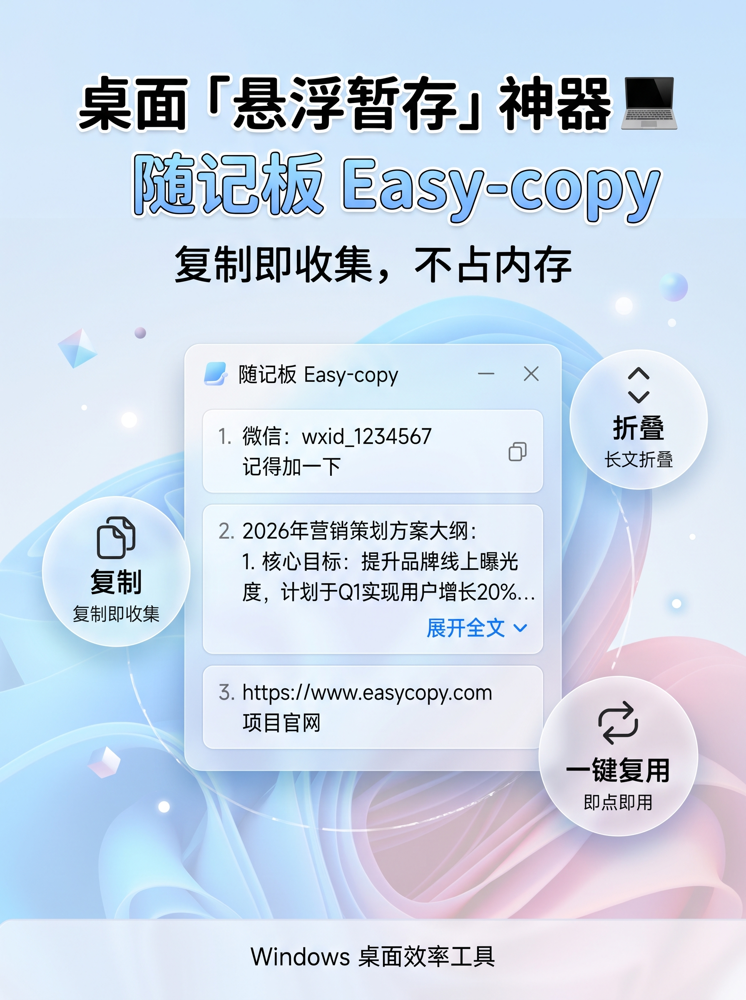
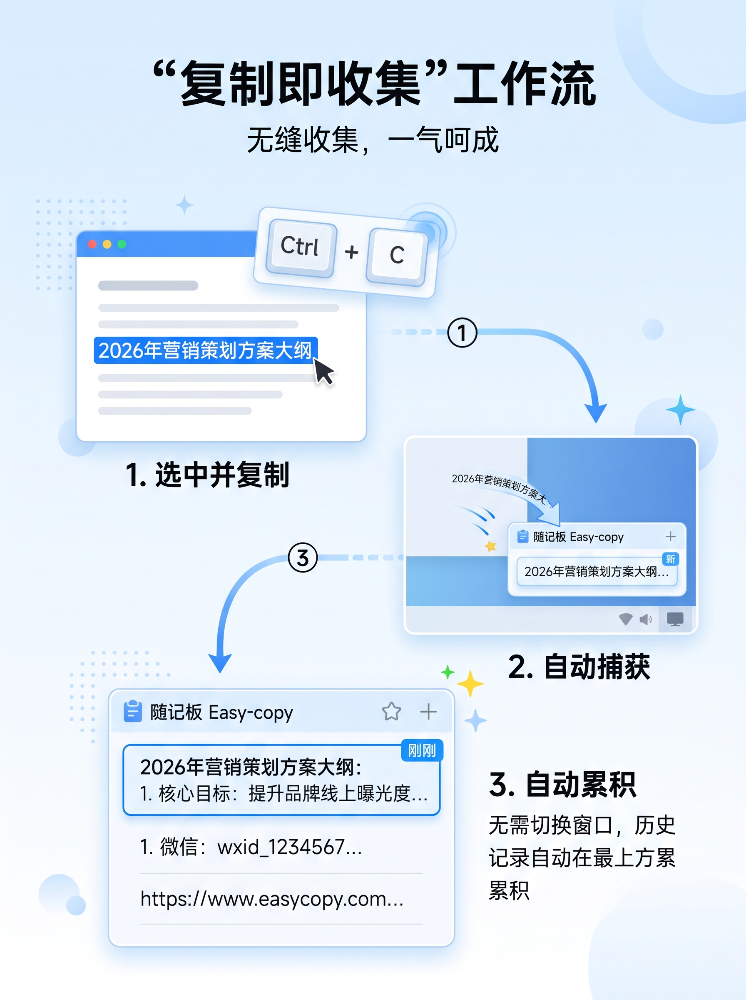
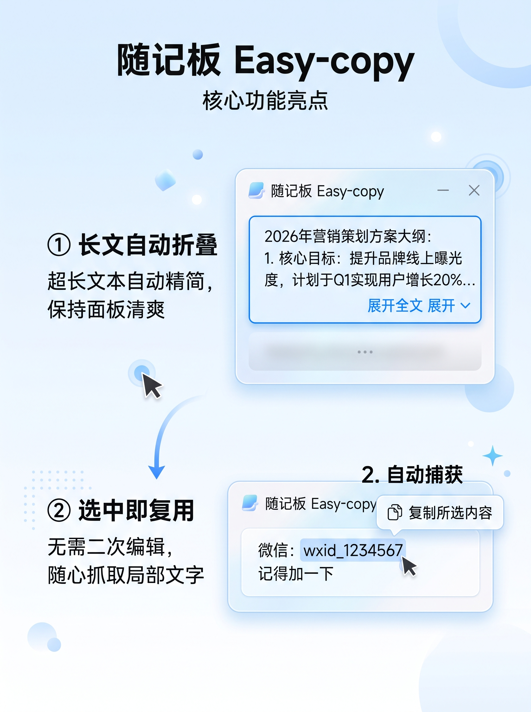
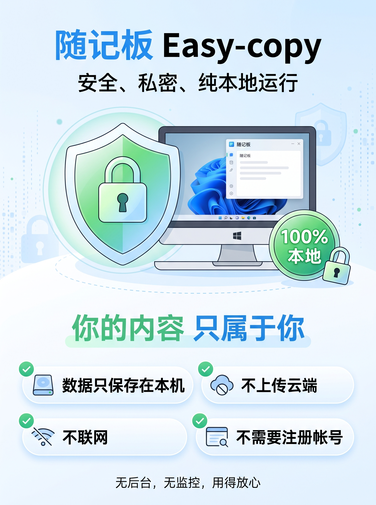
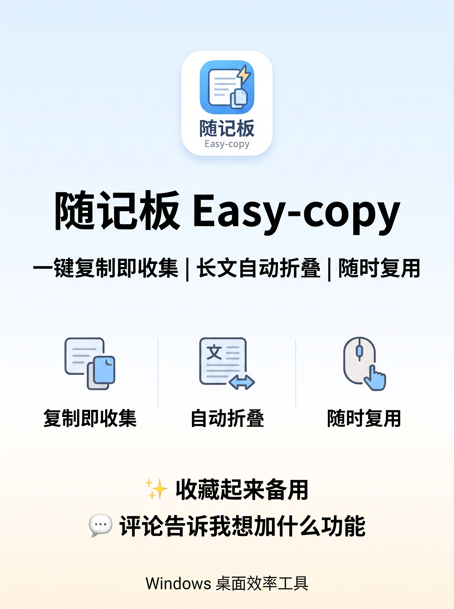

# 随记板 Easy-copy

  

**复制即收集，不占内存。** 一款完全本地运行的 Windows 桌面悬浮文本暂存工具。

日常复制的内容，转瞬就被下一次复制覆盖？想找刚才那条网址、那段文案、那个验证码，只能翻聊天记录？随记板帮你把每一次复制都自动留下来，需要时一键取回。

## ✨ 它是怎么工作的

  

无需切换窗口、无需手动粘贴保存 —— 在任意应用中按下 `Ctrl+C`，内容就会自动飞进随记板的悬浮面板，按时间从上到下积累。历史记录始终在手边，随用随取。

## 🎯 两个最省心的细节

  

- **长文自动折叠**：超长文本默认只显示几行，保持面板清爽，点「展开全文」再看全文；
- **选中即复用**：拖选一段文字按 `Ctrl+C`，只复制所选片段，并作为新记录出现在最上方 —— 不用二次编辑，抓取局部内容特别方便。

其他顺手的设计也都在：双击即可修改任意记录、右键删除单条、重复内容自动置顶、窗口位置大小自动记忆、始终悬浮置顶、浅色/深色主题随你切换。

## 🔒 你的内容只属于你

  

- ✅ 数据只保存在本机
- ✅ 不上传云端
- ✅ 不联网
- ✅ 不需要注册帐号

无后台、无监控、无广告。记录以 JSON 文件存放在本机 `%LOCALAPPDATA%\Easy-copy\`，清空即删除，用得放心。

## 💾 下载使用

无需安装、无需任何运行环境 —— 下载仓库 Release 中的 `Easy-copy.exe`（单文件，约 53MB），双击即可运行（64 位 Windows）。软件启动后驻留系统托盘，复制文本时窗口自动弹出，点「×」或 `Esc` 即可收起。

## 🤝 一起完善

  

随手复制、随手取用 —— 希望它能帮你省下一点折腾的时间。欢迎提 Issue / PR，或在讨论区告诉我想加什么功能。
